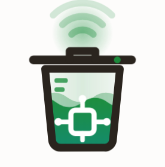
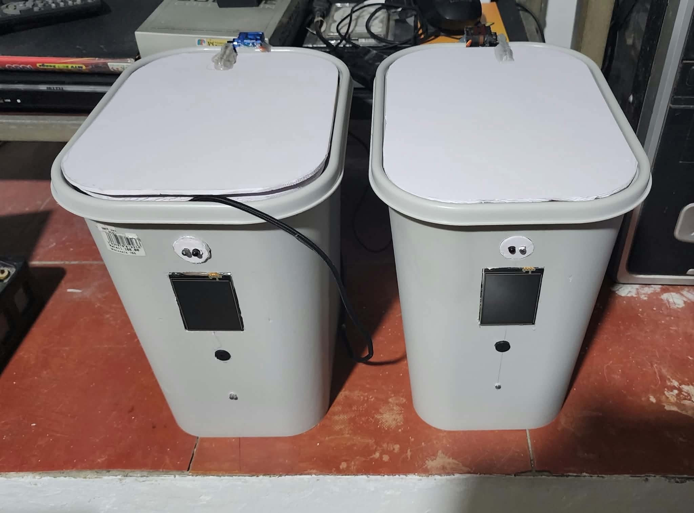
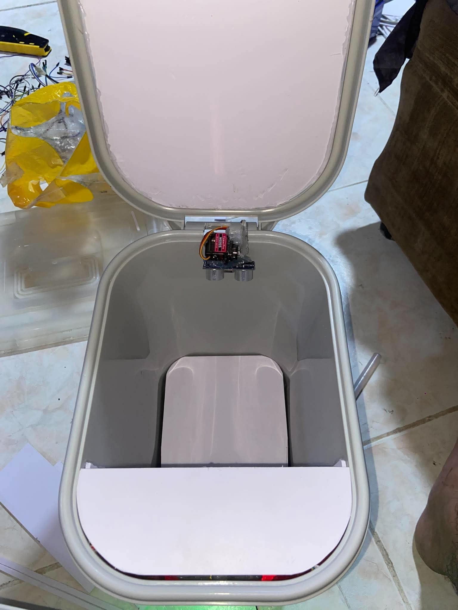
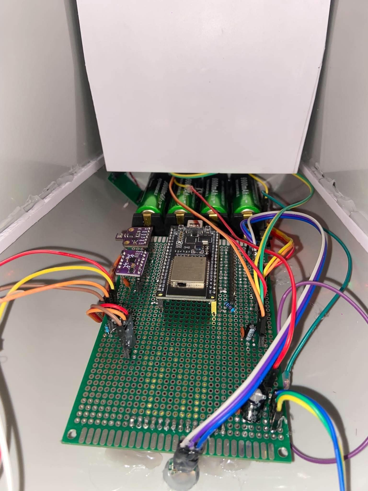
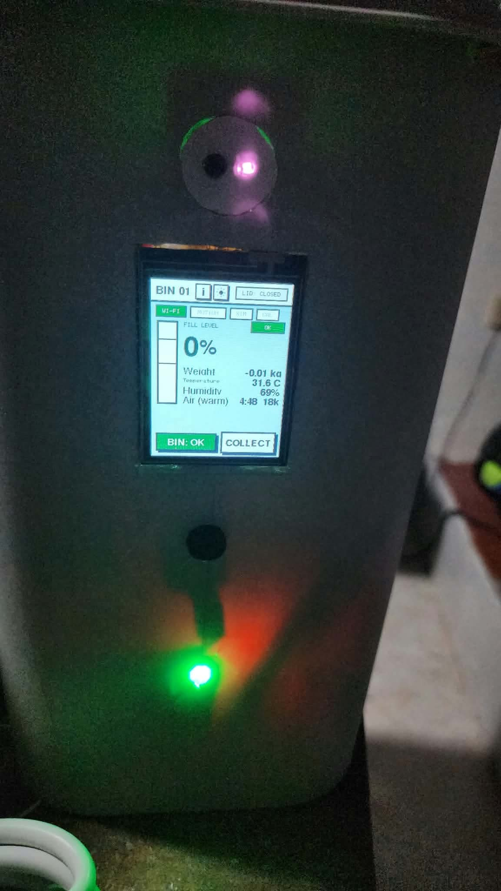
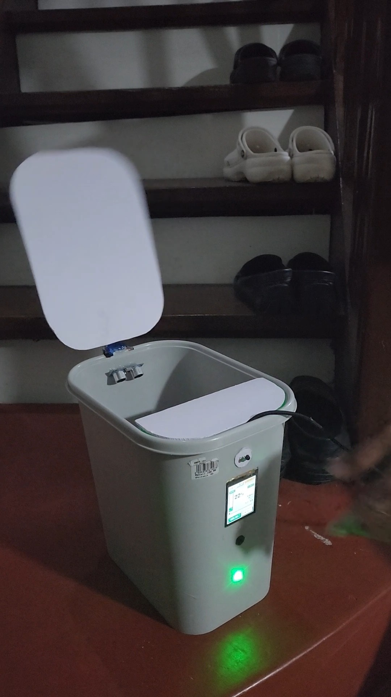

  

<h1 align="center">Smart-Bin</h1>

  An ESP32-based IoT waste bin monitoring system with fill, weight, air-quality and tamper detection for priority-based collection. 
  Embedded Systems: Final Project | TUP Manila | BET-CPET 4A-M, Group 2

  <a href="Documents/SMART-BIN%20v26.pdf"><b>Paper (PDF)</b></a> ·
  <a href="Documents/Smart-Bin%20Poster%20(3x5ft).pdf"><b>Poster</b></a> ·
  <a href="Android%20App/Smart-Bin%20v3.1.apk"><b>Android app (APK)</b></a> ·
  <a href="Web%20Dashboard/smartbin-dashboard.html"><b>Web dashboard</b></a> ·
  <a href="firmware/"><b>Firmware</b></a>

  

## What it is

Overflowing bins and fixed collection routes waste trips: collectors visit bins that are half empty and miss the ones that are full. Smart-Bin puts the readings in front of them instead.

Two table-size bins, Bin A and Bin B, each run their own ESP32. Each bin measures how full and how heavy it is and the temperature, humidity, pressure and air quality inside it. It opens its lid when a hand comes near, raises an alarm when it is tilted or moved, and can be locked from a phone. It reports to three interfaces:

- a **web dashboard** for the operator (admin),
- an **Android app** for the collector (and the operator),
- a **2.4in touchscreen** on each bin, where a collector types a PIN to start a pickup.

The **Collection Priority** list ranks the bins by fill level and estimated time to full (NOW, SOON, TODAY, LATER, IDLE), so the fullest bin is emptied first.

Readings reach the interfaces three ways. On the same Wi-Fi, the dashboard and the app talk to a bin directly (about 1s). Away from it, **Firebase** carries the live status, commands and alerts, and **ThingSpeak** keeps the history for charts. This makes Smart-Bin an IoT Level 6 system: independent end nodes, cloud storage and analysis, and a central controller that sends commands back.

## The built bins

| Inside Bin A | Controller and battery bay | Touchscreen and IR sensor | Lid opening for a hand |
|---|---|---|---|
|  |  |  |  |

The servo and the HC-SR04 sit on a strip at the lid hinge, facing down into the chamber. The ESP32 perfboard, the BME680 and BMI160 modules and the 18650 battery shield sit in a bay behind the front wall. Bin A runs on four 18650 cells and Bin B on two.

## How it works

  

| Block diagram | Prototype design |
|---|---|
|  |  |

The full figures are in [`Documents/Figures`](Documents/Figures): the [system flowchart](Documents/Figures/SmartBin_System_Flowchart%20%28white%29.png), the [operator](Documents/Figures/SmartBin_Operator_Flowchart%20%28white%29.png) and [collector](Documents/Figures/SmartBin_Collector_Flowchart%20%28white%29.png) flowcharts, the [IPO framework](Documents/Figures/SmartBin_IPO_Framework%20%28white%29.png), the [development life cycle](Documents/Figures/SmartBin_SDLC%20%28white%29.png) and the [Gantt chart](Documents/Figures/SmartBin_Gantt_Chart_Portrait.pdf).

## Web dashboard

One HTML file. Each bin serves it at `http://<bin-ip>/`, and it also opens straight from the folder. Shown here with DEMO on (three made-up bins).

  

| Charts | Alerts | Dark theme |
|---|---|---|
|  |  |  |

More in [`Web Dashboard/README.md`](Web%20Dashboard/README.md).

## Android app

Kotlin and Jetpack Compose, version 3.1. Install [`Smart-Bin v3.1.apk`](Android%20App/Smart-Bin%20v3.1.apk) on a phone, or open the `Android App` folder in Android Studio.

| Overview | Charts | Pickup | Bluetooth setup | Dark theme |
|---|---|---|---|---|
|  |  |  |  |  |

| Tilt sensor | Lid timing | Weight | Touchscreen | Alert limits |
|---|---|---|---|---|
|  |  |  |  |  |

More in [`Android App/README.md`](Android%20App/README.md).

## Hardware per bin

| Part | Job |
|---|---|
| ESP32-WROOM-32D DevKit | Controller |
| HC-SR04 ultrasonic sensor | Fill level (median of 5 readings) |
| HX711 + 5kg load cell | Weight |
| BME680 | Temperature, humidity, pressure, estimated air quality (IAQ) |
| BMI160 | Tilt and tamper |
| FC-51 IR obstacle sensor (3.3V) | Hand detection for the lid |
| SG90 servo | Lid |
| 2.4in ILI9341 TFT + XPT2046 touch | On-bin screen and PIN pad |
| RGB LED, buzzer module | Status light and alarms |
| 18650 battery shield | Power (4 cells in Bin A, 2 in Bin B) |

The schematic is [`Hardware/Smart-bin_Schematic_Diagram v3.pdf`](Hardware/Smart-bin_Schematic_Diagram%20v3.pdf). The bill of materials is Appendix B of the paper.

## Get it running

1. **Firmware.** Follow [`firmware/README.md`](firmware/README.md): install Arduino IDE 2 and the libraries, copy `secrets.example.h` to `secrets.h`, set `BIN_NUMBER`, upload with the *Huge APP* partition, then calibrate on the bench.
2. **Dashboard.** Open `http://<bin-ip>/` from any browser on the bin's Wi-Fi.
3. **App.** Install the APK, pick Operator or Collector, and pair a bin over Bluetooth or type its IP in its SET sheet.
4. **Cloud (optional).** Create the Firebase project and the ThingSpeak channels as described in the firmware README, sections 4 and 5.

No hardware? Switch DEMO on at the start page of the dashboard or the app, or run the mock bins: `python "Android App/tools/smartbin_mock_server.py" --bins 2`.

`secrets.h` and `local.properties` are git-ignored. Do not commit Wi-Fi passwords, Firebase or ThingSpeak keys, or the real Collect PIN.

## Repository layout

| Folder | Contents |
|---|---|
| [`firmware/`](firmware) | ESP32 sketch (`SmartBin/`), Firebase rules, the dashboard packer |
| [`Web Dashboard/`](Web%20Dashboard) | `smartbin-dashboard.html`, the operator dashboard |
| [`Android App/`](Android%20App) | Android Studio project, the ready-built `Smart-Bin v3.1.apk`, sound maker and mock bin server |
| [`Hardware/`](Hardware) | Schematic |
| [`Documents/`](Documents) | Final paper `SMART-BIN v26` (.docx and .pdf), poster, link to the online draft |
| [`Documents/Figures/`](Documents/Figures) | Diagrams (HTML source and PNG), Gantt chart, prototype photos, app and dashboard screens, logo |

## Team

| Member | Main work |
|---|---|
| Reyes II, Genesis Walter D. | Firmware, web dashboard, block diagram |
| Celeste, Brian Jay | Android app, component materials, system flowchart |
| Banogbanog, Rodel S. | Prototype design, bin build and wiring |
| Gunayan, Jade C. | Bin build and wiring, related literature, frameworks |
| Pepito, King Perth G. | Related literature, SWOT, frameworks |

Instructor: Prof. Jonel R. Macalisang. Technological University of the Philippines, Manila. November 2026.
